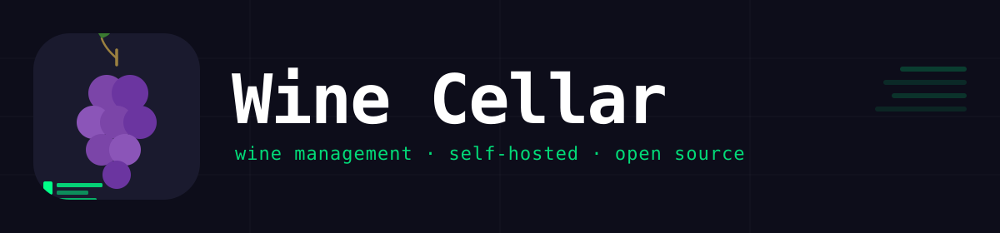

# Wine Cellar

> Personal fork of [KellerLog](https://github.com/KrapfalAT/kellerlog) (MIT, by KrapfalAT), rebranded and extended for my own cellar. Environment variables (`KELLERLOG_*`) and the `kellerlog/` data folder keep their upstream names so existing deployments and upstream merges keep working.

A self-hosted wine cellar management app. Track your collection, scan barcodes, manage inventory, and share a read-only kiosk view for guests.



## Fork additions

- **Food pairings:** 21 categories (picker with icons) stored as keys in the existing `pairings` field; free text still works.
- **Taste profile:** fruit and personality scores (1-5) drawn as a round badge, plus sweetness (sec / doux / moelleux).
- **Optional link** per wine (http/https only).
- **French wine regions:** 10 regions with appellation lists are seeded automatically; a wine whose `region` text contains a region name or one of its appellations shows that region's map and text. Intro texts and map images are not in this repository (third-party material). Load your own with `scripts/load_region_assets.py` (see its docstring), or edit a region via `PUT /regions/{key}` and `POST /upload`.

- **Appellation map (France):** the map view draws the delimited area of each appellation your wines belong to (strong fill when the appellation is known, light fill for region-only wines). Polygons are built from the INAO list of AOC/AOP communes ([data.gouv.fr](https://www.data.gouv.fr/datasets/aires-geographiques-des-aoc-aop), Licence Ouverte) joined with commune outlines from [geo.api.gouv.fr](https://geo.api.gouv.fr) (IGN, open data) by `scripts/build_appellation_geo.py`; commune level, so borders are approximate. Output: `frontend/static/geo/appellations.geojson`.

- **Database backups:** a consistent SQLite copy (`<data>/backups/wines-<date>-<reason>.db`) is made before every app start (at most once an hour), then daily; the newest 14 of each kind are kept (`BACKUP_KEEP`, `BACKUPS_DIR`). List, "Back up now" and download are in the Backup & Import panel (`GET/POST /backups`, `GET /backups/{name}`). Photos live in the same data folder; take an off-NAS copy of the whole folder (Hyper Backup) for disk failures.

- **EU e-label (QR scan):** scanning the QR code on a bottle that carries a ScanTrust e-label (`*.st4.ch` / `elabel.scantrust.com` link) fills the form from the label data: name, grape, vintage, alcohol, colour, sweetness, description, ingredients, nutrition per 100 ml and bottler. The add form shows a preview with one checkbox per field; nothing is overwritten silently. The backend resolves the link itself (`POST /elabel/resolve`, allow-listed hosts only, one request per scan). The EAN barcode alone cannot be mapped to an e-label; the QR link is the identifier.

- **Fill from link (supported shops):** e.leclerc (`/fp/` pages) and La Compagnie des Bonnes Bouteilles (`/produit/` pages); the ⓘ icon next to the URL field lists the supported sites and the fields each one fills (`GET /fill-sources`). Each site has its own small parser module registered in `backend/sources.py`.
- **Fill from link, any other shop (basic data):** for every other https product page the generic reader takes what the page states in standard product data (JSON-LD `Product`, then OpenGraph tags): name, brand, description, photo, price, EAN, plus a guessed vintage, alcohol and colour. Safety: https on port 443 only, public hosts only (every redirect is re-checked), HTML only, 4 MB cap, one request per click.
- **Fill from link, e.leclerc details:** paste an `https://www.e.leclerc/fp/...` product link in the URL field and press "Fill from link": the backend reads that one page (`POST /fill-from-url`, only that host, tracking parameters stripped) and the form shows a preview with a checkbox per field (name, grape, vintage, region and appellation, alcohol, volume, pairings, fruit and personality scales, "potentiel de garde", serving temperature, tasting notes, price, EAN and photo). Nothing is stored from the page except what you confirm. New wine fields: `keep_until_years` (overrides the drink-window rule's end year), `serving_temp`, `purchase_date`, `tasting`. Personal use, one request per action; retailer texts are never part of this repository.

- **Longer region texts:** each region can carry an extra text and its source link (`extra`, `extra_source` on `PUT /regions/{key}`), shown under "More about this region". `scripts/fetch_leclerc_region_texts.py` reads the region paragraph e.leclerc shows on its wine pages (about 20 polite requests, texts written outside the repository) and `scripts/load_region_extra.py` uploads them. Leclerc's Savoie/Jura pages show the Alsace paragraph, so that region is skipped.
- **Wishlist:** `wishlist` and `target_price` on wines. A wished wine can have 0 bottles: `GET /wines?include_wishlist=true` (main page only) adds those, the default list, kiosk, map, regions and stats still show stock only. The Wishlist chip lists wished wines; "Bought" opens the edit form as a purchase (off the wishlist, one more bottle, today's date, target price as price). Export/import carry both fields.
- **Add from links** (menu, admin): paste several product links or the text of a whole order or cart; each https link is read with "fill from link", the rows can be reviewed (bottles or target price, include or skip) and are then added to the cellar or the wishlist in one go. `POST /fill-from-url` returns `existing_wine_id` (same EAN, else same link), so a known bottle gets the bottles added instead of a duplicate, and a wished bottle bought this way (or with quick-add / the inventory scan) leaves the wishlist. For e.leclerc pages the producer is taken from names starting with Château, Domaine, Clos…, and an appellation that the shop files under the wrong region (Fronton under Bordeaux) gets the region from `regions_seed.py`.
- **Title migration:** an app title that is still exactly `KellerLog` (the old default) is renamed to `Wine Cellar` at startup; custom titles are never touched.

## Changelog convention

The footer shows the newest entry of `frontend/src/lib/changelog.js` plus the running build (commit and date, baked into the frontend image by CI as `APP_SHA` / `APP_BUILD_DATE`); clicking the version opens the changelog. Every PR that changes behaviour adds an entry at the top of that file in the same PR. The version is the release date (`2026-10-14`, then `.2`, `.3` for more the same day); optional status `planned` / `in-progress` for work spread over several PRs.

## Off-NAS backup (pull from a Mac)

The app already writes consistent database copies (`data/backups/wines-<date>-startup|daily|manual.db`, see "Database backups"). To survive a NAS disk failure you also need a copy on **another device**:

1. One-time, on the Mac: `ssh-copy-id dolean_j@nashome` (you type the NAS password once; nothing is stored).
2. Take a first snapshot: `scripts/backup_pull_from_nas.sh`. It pulls `data/` over SSH with rsync into `~/Backups/wine-cellar/<date>/` (photos and the app's database copies; the live `wines.db` is skipped on purpose, a file copied while the app writes can be corrupt), opens the newest database copy to check it is intact and keeps the newest 30 snapshots (unchanged files are hard links, so a snapshot costs only what changed). `--check` re-verifies the newest snapshot.
3. Make it daily: `scripts/install_backup_agent.sh install` (launchd agent, 03:30, runs at wake if the Mac slept; log `~/Library/Logs/wine-cellar-backup.log`; a failed run shows a macOS notification).

Settings go in `~/.config/wine-cellar-backup.env` (`NAS_USER`, `NAS_HOST`, `REMOTE_DIR`, `DEST`, `KEEP`). Point `DEST` at a Time Machine or cloud-synced folder to make the copy leave the house too. The freshest database is at most one day old (the app's daily backup).

**Restore** (new NAS or after a disk failure): stop the project, copy the newest `backups/wines-*.db` of a snapshot to `data/wines.db`, copy `images/` to `data/images/`, make the files readable by the container user, start the project. Test it once on a copy before you need it.

## Screenshots

| Collection | Wine Details | Kiosk |
|:---:|:---:|:---:|
|  |  |  |

---

## Features

**Collection management**
- Add, edit, and delete wines with photos, tasting notes, ratings, and food pairings
- Filter by type, sort by date / rating / quantity, full-text search
- Batch edit — select multiple wines and update type, region, or location at once
- Click any wine to open a detail panel with a full-screen image lightbox
- Audit trail — each entry records who created and last edited it, shown in the detail view

**Photo search**
- Paste an image straight from the clipboard (Ctrl+V) while adding or editing a wine
- Or search by name via the Brave Image Search API, with a Google Images link as fallback

**Custom fields**
- Define your own fields to track anything the built-in schema doesn't cover
- Configurable via the hamburger menu → **Custom Fields**; appear on every wine automatically

**By-the-glass mode**
- Mark a wine as available by the glass with its own price
- Shown separately in the kiosk view for restaurant- or event-style setups

**Barcode scanner**
- Scan a bottle's EAN/UPC to auto-fill wine details from the local library
- Works on mobile via the camera; also available as a manual text input

**Wine library**
- Shared database of wine metadata, separate from inventory counts
- Add any library entry to inventory with one click; edits propagate to the live collection
- Autocomplete while typing a wine name pulls from the library

**Inventory mode**
- Dedicated mode with +/− controls for fast stock adjustment
- Wines that reach zero bottles are removed automatically when you exit

**Kiosk view** (`/kiosk`)
- Clean, public, read-only wine list for guests or a wall display
- Configurable title, subtitle, map button, footer, drink-window display, and on/off toggle
- Real-time updates — refreshes automatically when the collection changes

**Drink window**
- Define rules per wine type (e.g. "drink Riesling between 3 and 8 years after vintage")
- Each wine card shows whether it's ready to drink, too young, or past peak

**Real-time sync**
- Dashboard and kiosk update instantly across all connected devices via Server-Sent Events (SSE)
- No polling — changes appear within a second of being saved

**Wine map**
- World map showing where your wines come from
- Automatic geocoding for unknown regions via Nominatim

**Import / Export**
- Full backup and restore as JSON or CSV

**Branding**
- Customize the app title, subtitle, logo, accent color, and dark/light mode
- Settings are stored server-side and apply to all users and devices immediately

**User accounts**
- JWT-based auth with Admin and Viewer roles
- Admins have full read/write access; Viewers are read-only

**PWA**
- Installable as a home-screen app on iOS, Android, and desktop
- Service worker caches the app shell; API calls always go to the network

**i18n**
- German and English UI; switchable per user

**Security**
- Login is rate-limited (5/minute, 20/hour per IP) to slow down brute-force attempts
- Strict CSP and security headers (`X-Frame-Options`, `X-Content-Type-Options`, `Referrer-Policy`) on every response
- Interactive API docs (Swagger/ReDoc) are disabled; the OpenAPI schema is not exposed
- Cross-origin access is opt-in via `ALLOWED_ORIGINS` — closed by default

---

## Docker Images

Images are published to GitHub Container Registry by CI on every push to `main`:

| Image | Tags |
|-------|------|
| `ghcr.io/doleanj/wine-cellar-frontend` | `edge` (latest `main`, what the NAS runs), `sha-<commit>` |
| `ghcr.io/doleanj/wine-cellar-backend` | `edge` (latest `main`, what the NAS runs), `sha-<commit>` |

Each push also creates a `build-…` GitHub pre-release with its notes. `latest` only moves on a tagged GitHub release; the last one is the upstream KellerLog v1.5.0 (July 2026), so use `edge`. Images are built for `linux/amd64` only.

The app version is the newest entry of `frontend/src/lib/changelog.js` (shown in the footer), not `package.json`.

---

## Getting Started

### Prerequisites

- Docker and Docker Compose

### Installation

**1. Create `docker-compose.yml`**

```yaml
services:
  backend:
    image: ghcr.io/doleanj/wine-cellar-backend:edge
    volumes:
      - ./kellerlog:/app/data
    environment:
      - KELLERLOG_SECRET_KEY=${KELLERLOG_SECRET_KEY}
      - KELLERLOG_ADMIN_USER=${KELLERLOG_ADMIN_USER:-admin}
      - KELLERLOG_ADMIN_PASSWORD=${KELLERLOG_ADMIN_PASSWORD}
    restart: unless-stopped

  frontend:
    image: ghcr.io/doleanj/wine-cellar-frontend:edge
    ports:
      - "8080:80"
    depends_on:
      - backend
    environment:
      - BACKEND_HOST=backend
    restart: unless-stopped
```

**2. Create `.env`**

```env
# Required — generate with: python3 -c "import secrets; print(secrets.token_hex(32))"
# Must remain stable across restarts; changing it invalidates all sessions.
KELLERLOG_SECRET_KEY=your_secret_key_here

# Admin account (created on first run if no users exist)
KELLERLOG_ADMIN_USER=admin
KELLERLOG_ADMIN_PASSWORD=your_admin_password_here

# Optional — enables photo search when adding/editing a wine
BRAVE_SEARCH_KEY=

# Optional — comma-separated CORS allow-list, only needed for cross-origin setups
ALLOWED_ORIGINS=
```

> If `KELLERLOG_ADMIN_PASSWORD` is not set, a random password is generated at startup and printed once to the container logs.

**3. Start**

```bash
docker compose up -d
```

Open [http://localhost:8080](http://localhost:8080) and log in.

### Updating

```bash
docker compose pull && docker compose up -d
```

---

## Configuration

### Environment variables

| Variable | Required | Default | Description |
|----------|----------|---------|-------------|
| `KELLERLOG_SECRET_KEY` | **Yes** | — | JWT signing secret. Must persist across restarts. |
| `KELLERLOG_ADMIN_USER` | No | `admin` | Username for the initial admin account (first run only). |
| `KELLERLOG_ADMIN_PASSWORD` | Recommended | *(auto-generated)* | Password for the initial admin account. |
| `BACKEND_HOST` | No | `backend` | Hostname of the backend service as seen by nginx. |
| `BRAVE_SEARCH_KEY` | No | — | Brave Search API key. Enables photo search when adding/editing a wine; omit to disable. |
| `ALLOWED_ORIGINS` | No | *(none)* | Comma-separated list of allowed CORS origins, e.g. for accessing the API from a different domain. |

### User management

Admins can create, edit, and delete user accounts via the hamburger menu → **User Management**. Two roles:

- **Admin** — full read/write access
- **Viewer** — read-only; cannot add, edit, or delete wines

### Kiosk

The kiosk view at `/kiosk` is publicly accessible without login. Configure it via the hamburger menu → **Kiosk Settings**:

- Enable or disable the kiosk entirely
- Set the title and subtitle shown in the kiosk header
- Toggle the map button, footer, and drink-window indicator

### Branding

App name, logo, accent color, and dark mode are configurable through the hamburger menu → **Branding**. Settings are stored server-side and apply immediately to all devices.

### Data

All wine data and uploaded images are stored in the `kellerlog/` directory (created automatically). Back it up regularly.

---

## Routes

| Path | Auth | Description |
|------|------|-------------|
| `/` | Required | Main collection view |
| `/login` | — | Login page |
| `/kiosk` | — | Read-only guest view |

---

## API

The backend exposes a REST API at `/api/`. Write endpoints require a `Bearer` token obtained via `POST /api/auth/login`.

### Auth

| Method | Path | Auth | Description |
|--------|------|------|-------------|
| `POST` | `/api/auth/login` | — | Login; returns JWT |
| `GET` | `/api/auth/me` | Any | Current user info |
| `GET` | `/api/auth/users` | Admin | List all users |
| `POST` | `/api/auth/users` | Admin | Create user |
| `PUT` | `/api/auth/users/{id}` | Admin | Update user |
| `DELETE` | `/api/auth/users/{id}` | Admin | Delete user |

### Wines

| Method | Path | Auth | Description |
|--------|------|------|-------------|
| `GET` | `/api/wines` | Login or Kiosk | List wines |
| `POST` | `/api/wines` | Admin | Add wine |
| `PUT` | `/api/wines/{id}` | Admin | Update wine |
| `PUT` | `/api/wines/batch` | Admin | Batch update |
| `DELETE` | `/api/wines/{id}` | Admin | Delete wine |
| `GET` | `/api/stats` | Login | Collection statistics |
| `GET` | `/api/lookup/{barcode}` | Login | Local library barcode lookup |
| `GET` | `/api/export/json` | Login | Export as JSON |
| `GET` | `/api/export/csv` | Login | Export as CSV |
| `POST` | `/api/import` | Admin | Import JSON or CSV |
| `GET` | `/api/image-search` | Login | Photo search via Brave Image Search API |

### Library

| Method | Path | Auth | Description |
|--------|------|------|-------------|
| `GET` | `/api/library` | Login | List library entries |
| `GET` | `/api/library/search?q=` | Login | Search library |
| `PUT` | `/api/library/{id}` | Admin | Update library entry |
| `DELETE` | `/api/library/{id}` | Admin | Delete library entry |

### Settings & configuration

| Method | Path | Auth | Description |
|--------|------|------|-------------|
| `GET` | `/api/settings` | Login or Kiosk | App and kiosk settings |
| `PUT` | `/api/settings` | Admin | Update settings |
| `GET` | `/api/drink-rules` | Login or Kiosk | List drink-window rules |
| `POST` | `/api/drink-rules` | Admin | Create rule |
| `PUT` | `/api/drink-rules/{id}` | Admin | Update rule |
| `DELETE` | `/api/drink-rules/{id}` | Admin | Delete rule |
| `GET` | `/api/custom-fields` | Login or Kiosk | List custom fields |
| `POST` | `/api/custom-fields` | Admin | Create custom field |
| `PUT` | `/api/custom-fields/{id}` | Admin | Update custom field |
| `DELETE` | `/api/custom-fields/{id}` | Admin | Delete custom field |

### Real-time

| Method | Path | Auth | Description |
|--------|------|------|-------------|
| `GET` | `/api/events` | Login or Kiosk | SSE stream; emits `wines` event on any collection change |

---

## Tech Stack

| Layer | Technology |
|-------|-----------|
| Frontend | SvelteKit (SPA, static adapter) + Svelte 5 |
| Backend | FastAPI + SQLAlchemy |
| Database | SQLite |
| Proxy | nginx |
| Deployment | Docker Compose |
| Real-time | Server-Sent Events (SSE) |

---

## AI Disclaimer

This project was built with the assistance of [Claude Code](https://claude.ai/code) by Anthropic. AI-generated code has been reviewed and tested, but may contain imperfections. Use at your own risk.

## License

MIT
